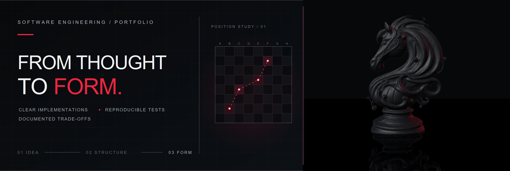

<a href="#english">EN</a> · <a href="#portugues">PT-BR</a>

  

<h1 align="center">Bruno Florian</h1>

<strong>Software engineering, from thought to form.</strong> Engenharia de software, da ideia à forma.

  <a href="https://brunoflorian.pages.dev/"><strong>PORTFOLIO ↗</strong></a>
  &nbsp; · &nbsp;
  <a href="https://github.com/engineering-proof-labs">ENGINEERING PROOF LABS</a>
  &nbsp; · &nbsp;
  <a href="https://www.linkedin.com/in/rbrunoflorian/">LINKEDIN</a>

---

## English

I build software with clear implementations, reproducible tests, and documented trade-offs. My focus is making a system's behavior and the decisions behind it easy to inspect.

### Selected work

<table>
  <tr>
    <td width="33%" valign="top"><strong>01 · Portfolio</strong>  A bilingual site for engineering work, experiments, and ideas. The Home combines a Three.js scene with accessible navigation and a static fallback.  <a href="https://brunoflorian.pages.dev/">Visit the site ↗</a></td>
    <td width="33%" valign="top"><strong>02 · Engineering Proof Labs</strong>  Focused engineering repositories built around working examples, reproducible checks, and clearly stated limits.  <a href="https://github.com/engineering-proof-labs">Explore the labs ↗</a></td>
    <td width="33%" valign="top"><strong>03 · Rate Limiting Lab</strong>  A TypeScript, Node.js, Express, and Redis lab covering rate-limit algorithms, HTTP middleware, and unit, contract, and integration tests.  <a href="https://github.com/engineering-proof-labs/rate-limiting-lab">Read the repository ↗</a></td>
  </tr>
</table>

### Technologies in these projects

`HTML` · `CSS` · `JavaScript ES modules` · `Three.js` · `TypeScript` · `Node.js` · `Express` · `Redis` · `Vitest`

### Contact

[LinkedIn](https://www.linkedin.com/in/rbrunoflorian/) · [Email](mailto:dev.brunoflorian@gmail.com)

---

## Português

Desenvolvo software com implementações claras, testes reproduzíveis e trade-offs documentados. Meu foco é tornar o comportamento dos sistemas e as decisões por trás deles fáceis de examinar.

### Projetos em destaque

<table>
  <tr>
    <td width="33%" valign="top"><strong>01 · Portfólio</strong>  Um site bilíngue sobre engenharia de software, experimentos e ideias. A Home combina uma cena em Three.js com navegação acessível e uma apresentação estática alternativa.  <a href="https://brunoflorian.pages.dev/pt-br/">Visitar o site ↗</a></td>
    <td width="33%" valign="top"><strong>02 · Engineering Proof Labs</strong>  Repositórios focados em engenharia, organizados em torno de exemplos funcionais, verificações reproduzíveis e limites descritos com clareza.  <a href="https://github.com/engineering-proof-labs">Explorar os labs ↗</a></td>
    <td width="33%" valign="top"><strong>03 · Rate Limiting Lab</strong>  Um laboratório com TypeScript, Node.js, Express e Redis, cobrindo algoritmos de rate limit, middleware HTTP e testes unitários, de contrato e integração.  <a href="https://github.com/engineering-proof-labs/rate-limiting-lab">Ler o repositório ↗</a></td>
  </tr>
</table>

### Tecnologias nestes projetos

`HTML` · `CSS` · `JavaScript ES modules` · `Three.js` · `TypeScript` · `Node.js` · `Express` · `Redis` · `Vitest`

### Contato

[LinkedIn](https://www.linkedin.com/in/rbrunoflorian/) · [E-mail](mailto:dev.brunoflorian@gmail.com)

Image: “Chess Knight 006” by Vijay Saini, CC BY 4.0; optimized and recolored for the portfolio. <a href="https://skfb.ly/pEJVJ">Source</a> · <a href="https://creativecommons.org/licenses/by/4.0/">License</a>. Imagem: “Chess Knight 006”, de Vijay Saini, CC BY 4.0; modelo otimizado e recolorido para o portfólio. <a href="https://skfb.ly/pEJVJ">Origem</a> · <a href="https://creativecommons.org/licenses/by/4.0/">Licença</a>.